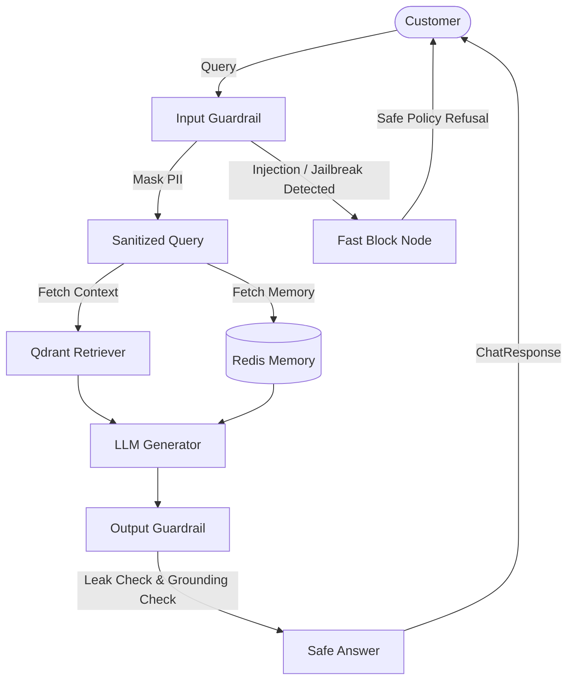

# Synk Corp Customer Support API & AI Assistant

An enterprise-ready customer support chatbot built with **FastAPI**, **LangGraph**, **Qdrant Vector Database (RAG)**, **Defense-in-Depth Guardrails**, and **Redis Conversation Memory**.

---

## 🌟 Key Architectural Features

1. **Defense-in-Depth Guardrails (`guardrails.py`)**:
   - **Prompt Injection & Jailbreak Prevention**: Blocks instruction overrides (`ignore previous instructions`, `DAN`, persona hijacks) before they reach the vector database or LLM.
   - **PII Redaction**: Automatically detects and masks sensitive data (Credit Cards, SSNs, API secrets) to protect customer privacy and prevent memory leaks.
   - **System Prompt Leak Suppression**: Inspects generated output to ensure internal prompt instructions and model delimiters are never regurgitated.
   - **Strict Grounding Enforcement**: Guarantees answers strictly reflect Synk Corp documents, falling back to a safe refusal when information is absent.

2. **Redis Conversation Memory (`memory.py`)**:
   - Multi-turn conversational memory partitioned by `session_id`.
   - **Sliding TTL Expiration**: Session keys automatically expire (default: 24h) and refresh on user activity.
   - **Sliding History Window**: Injects recent dialogue turns within context budget.
   - **Graceful Fallback**: If Redis is offline or undergoing maintenance, seamlessly falls back to an in-memory session manager without dropping requests or crashing the server.

3. **RAG & Vector Search (`rag.py`)**:
   - Decoupled, lazily initialized vector store preventing lock contention and startup freezes.
   - Grounded context retrieval from Synk Corp corporate documents stored in Qdrant.
   - Source document attribution and hallucination guardrails.

4. **Guarded LangGraph Workflow (`chatbot.py`)**:
   - StateGraph architecture with conditional routing:
     - `START` -> `input_guardrail` -> `[if safe: retrieve -> answer -> output_guardrail -> END] | [if blocked: guardrail_block -> END]`
   - Multi-lingual support: English, Nepali, and Romanized Nepali.

5. **Production FastAPI Service (`api.py`)**:
   - Async thread execution for CPU/network-bound LLM and RAG tasks.
   - Modern `lifespan` application lifecycle.
   - CORS middleware configured for frontend web and mobile clients.
   - OpenAPI / Swagger documentation (`/docs` and `/redoc`).
   - Detailed readiness & liveness probes (`/health`) including memory, RAG, and guardrails statuses.

---

## 🛡️ Guardrails Architecture



---

## 📡 API Endpoints Reference

| Method | Endpoint | Description |
|---|---|---|
| `GET` | `/` | Operational status and API metadata. |
| `GET` | `/health` | Health probe (API, Redis connection status & latency, Qdrant readiness, Guardrails info). |
| `POST` | `/chat` | Submit question with `session_id`; returns answer, referenced sources, and guardrail classification. |
| `GET` | `/chat/{session_id}/history` | Retrieve complete dialogue history stored in Redis for that session. |
| `DELETE` | `/chat/{session_id}` | Clear conversation history from Redis. |
| `GET` | `/docs` | Interactive Swagger UI documentation. |

### Example Chat Request:

```bash
curl -X POST "http://localhost:8000/chat" \
     -H "Content-Type: application/json" \
     -d '{
       "session_id": "client-123",
       "question": "What services does Synk Corp provide?"
     }'
```

### Example Chat Response:

```json
{
  "session_id": "client-123",
  "question": "What services does Synk Corp provide?",
  "answer": "Synk Corp specializes in AI consulting, custom software development...",
  "sources": ["synk_company_info.txt"],
  "guardrail_passed": true,
  "guardrail_category": "clean",
  "latency_ms": 1150.4
}
```
